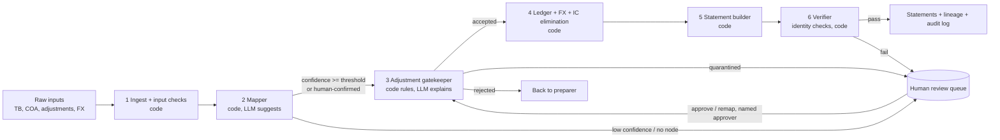

# Architecture: agentic financial statement generation

**Scope.** Design for the full pipeline (TB + COA + adjustments → BS, P&L, Cash Flow, SOCIE). One slice, the **manual adjustments agent**, is built and tested in this repo.
**Principle.** *Numbers come from code. The LLM handles judgment and language, and it can never change a number.* Where the LLM is used, its output is a suggestion or a sentence, and a deterministic gate checks it.

---

## 1. The problem is six problems

| # | Sub-problem | Reliability needed | Who does it |
|---|---|---|---|
| 1 | Ingest + validate inputs (schema, balance, duplicates, FX completeness) | exact | code |
| 2 | Map ERP accounts to COA nodes | high, with unknowns | code + **LLM suggests**, human confirms |
| 3 | Validate / classify manual adjustments | exact for rules, judgment for plausibility | code rules + **LLM explains** *(built)* |
| 4 | Post to ledger, translate FX, eliminate intercompany | exact | code |
| 5 | Build four statements + verify accounting identities | exact | code |
| 6 | Explain variances / failures to a human | fluent, but faithful | **LLM**, behind a guard |

"Generate financials" is not one prompt. It is a pipeline where five of six steps are arithmetic and rules, and the LLM earns its keep in the two places where inputs are ambiguous or a human needs to understand something.

## 2. Agent topology: one deterministic orchestrator, three narrow LLM roles



* **Orchestrator = a fixed pipeline in ordinary code**, not an LLM choosing next steps. Order never varies, so every run is reproducible and testable.
* **Three LLM roles, each single-shot with structured input/output:**
  1. *Mapping advisor*: proposes COA node + confidence for unmapped accounts.
  2. *Explainer*: turns structured findings into plain English (built, with a guard).
  3. *Variance narrator*: explains deltas between periods or TBs (designed only).
* **Why not a multi-agent swarm?** The steps are sequential and mostly deterministic. Agents negotiating with each other adds latency, cost and non-determinism and removes auditability. Why not one big agent with tools? Its control flow becomes non-reproducible, which is unacceptable for audit. A workflow with LLM calls at judgment points keeps the benefits and loses the risks.
* **Rule of thumb for adding an agent:** only when the step needs open-ended judgment *and* its output can be machine-checked afterwards.

## 3. Deterministic vs. LLM: where the line is

| Task | Deterministic code | LLM |
|---|---|---|
| Debits = credits, sums, FX math, roll-forwards, statement totals | ✅ always | ❌ never (LLMs make arithmetic slips) |
| Is the account in the COA? Is the date in period? Is it circular? | ✅ | ❌ |
| Which COA node does an unknown account belong to? | candidate ranking (name + code proximity) | proposes + reasons; **never auto-applied** |
| Does an adjustment look like a duplicate / double count? | rule checks on balances (e.g. R08) | explains why it matters |
| Telling the finance user *why* something was rejected | template sentence (always available) | rewrites wording; guard rejects any new number |
| Classifying a TBD cash-flow category | ❌ | proposes with rationale; human decides (policy choice) |

**Guard on LLM text:** every number in an LLM answer must already exist in the structured findings it was given, and it may not claim a held/rejected entry was posted. If it fails, the template text is used and the event is logged. A hallucinated figure therefore cannot reach a user.

## 4. Failure modes and how each is handled

| Failure mode | Handling | In prototype |
|---|---|---|
| **Hallucinated account mapping** | LLM output is only a *suggestion* with capped confidence (≤ 0.9). Mapping must exist in the COA, be a detail (non-header) account, and be confirmed by a named human or be above a threshold *and* previously approved. Approved mappings are stored versioned and reused, so the LLM is called once per novel account. | Suggestions only; approval required (R03) |
| **Debits ≠ credits after adjustments** | Entry-level check (R02) rejects the entry. Batch-level self-check: posted lines must net to zero or the run **aborts** (`PostingError`) rather than emit a wrong ledger. | R02 + post gate |
| **Account fits no COA node** | Quarantine, show ranked candidates, offer "add account to COA" vs "remap". Re-validation after remap catches bad fixes (e.g. remapping JE-005's 6315 to 6310 makes it circular). | R03 + re-validation |
| **FX rate missing** | Never guess or reuse the average rate silently. Flag the currency, exclude it from verified checks, block translation for that currency until a rate is supplied. | DQ-04, R07 |
| **Circular intercompany entry** | Net-zero detector (R04) rejects entries that cancel themselves; at consolidation, IC pairs must match across entities within tolerance or are quarantined. | R04 |
| **Duplicate rows / entries** | Rows keep source line IDs; duplicates are flagged, not silently dropped. Entries are content-hashed; same ID or same postings is flagged. | DQ-02, R06 |
| **Plausible-looking but wrong entry** | Cross-checks against the TB (e.g. depreciation already booked, FX reval recomputed from rates). | R07, R08 |
| **TB itself out of balance** | Reported with the exact difference; never plugged. Statements that depend on it are marked *provisional*. | DQ-01 |

## 5. Validation and self-correction loop

Gates run in order. Each is code. A failure never loops silently until it passes.

| Gate | Checks |
|---|---|
| **G1 Inputs** | file hashes recorded; TB balance; duplicate rows; FX completeness; COA hygiene (TBD categories, orphans) |
| **G2 Mapping** | every TB row maps to exactly one detail COA node; confidence/approval status recorded |
| **G3 Adjustments** | rules R01–R11 per entry → accept / warn / quarantine / reject *(built)* |
| **G4 Posting** | ledger Dr = Cr; TB + accepted adjustments = post-adjustment balance for every account |
| **G5 Statements** | Assets = Liabilities + Equity; P&L net income = net income in SOCIE; closing cash on cash-flow = balance-sheet cash; SOCIE closing equity = BS equity; every statement line = sum of its mapped accounts |
| **G6 Comparatives** | opening balances = prior closing; unexplained retained-earnings movement flagged |
| **G6b Restatements** | a prior-period correction is a new dated entry against the prior period, never an edit of history; comparatives are shown restated with a reconciliation to the originally reported figures, and the opening-balance change flows through SOCIE |
| **G7 Output guard** | any LLM text passes the number guard |

**When a check fails:**
1. *Classify:* data problem (needs the preparer), policy problem (needs an approver), or our bug.
2. *Safe auto-fix only if configured:* e.g. rounding below a stated tolerance goes to a named rounding account. Everything else is not auto-fixed.
3. *LLM may propose a fix; it never applies one.* A proposal is applied only after a human approves it and it is **re-run through the same gates** (max 2 rounds).
4. *Otherwise stop:* the statement is withheld or labelled provisional, with a worklist of what blocks it.

An internal inconsistency (G4/G5) raises an error and produces no statements. A wrong statement is worse than no statement.

## 6. Traceability: from a balance-sheet cell to source rows

Every number is a sum of **ledger lines**, and every ledger line points to its origin:

```
Balance Sheet cell: "Cash and cash equivalents" = 5,487,700.00   (as reported, untranslated)
 └─ statement line: BS.CurrentAssets.Cash        (statement-definition v3)
     └─ COA node 1110                            (mapping v7, approved_by ...)
         ├─ ledger line  TB  trial_balance.csv:2  USD 4,250,000.00   (file sha256 ...)
         ├─ ledger line  TB  trial_balance.csv:3  EUR 825,400.00     (translation: designed, not built)
         ├─ ledger line  TB  trial_balance.csv:4  GBP 412,300.00     (no period-end rate: flagged)
         └─ ADJ JE-003 line 1  +11,200.00  decision=QUARANTINED  -> excluded from the cell until approved
```

* **Lineage table** `cell_lineage(statement_cell_id, ledger_line_id, amount, sign)`. The statement is *derived* from it, so a cell cannot disagree with its sources.
* **Append-only** storage: nothing is updated in place. Corrections are new rows that reference what they supersede.
* **`run_id`** = hash(input file hashes, rules version, mapping version, config, resolutions). Same inputs ⇒ same run, same output bytes (tested). Re-running is idempotent.
* **Audit log** records every rule result (including passes), every finding with its numbers, every human override with approver and note, and every posted line.
* **Prototype evidence:** `output/post_adjustment_tb.csv` lists, per account, the source TB rows and the adjustment entries behind each balance; `output/audit_log.jsonl` has the full event trail.

## 7. Human-in-the-loop and override

* Three outcomes besides success: **reject** (preparer must fix), **quarantine** (a human decides), **warn** (posted, flagged).
* Approvals need `action: approve` + a **named approver** + a note. They are logged and the entry is re-validated before posting. Rejected entries cannot be overridden (they must be corrected and resubmitted).
* Approved mappings and decisions are stored and reused, so humans are not asked the same question twice.

## 8. Data model (relational, append-only)

`source_files(hash, name)` · `tb_lines(id, file_hash, row, account, ccy, dr, cr)` · `coa_versions` · `mappings(erp_account, coa_node, version, confidence, approved_by)` · `adjustments(id, content_hash, source)` · `adjustment_findings(entry, rule, severity, facts)` · `ledger_lines(id, origin, origin_ref, account, amount_usd)` · `statement_cells` · `cell_lineage` · `runs(run_id, config)` · `overrides(entry, approver, note)`.
Postgres is enough. No graph DB or vector store is needed for this problem.

## 9. Scaling (without over-engineering)

| Pressure | Approach |
|---|---|
| 1000s of accounts | Same code, vectorised (pandas/DuckDB). Cache mappings by `(erp, code, name-hash)` so the LLM only sees genuinely new accounts, batched. COA hierarchy as closure table. |
| Multi-entity consolidation | Add `entity_id` everywhere; IC elimination becomes its own stage (match pairs, tolerance, unmatched → quarantine); translate per entity, put differences in the FX translation reserve. |
| Many runs / users | Stateless workers over the append-only store; `run_id` makes retries safe. |
| Cost / latency | LLM only on exceptions (new accounts, flagged entries) plus short explanations. |
| Drift | Pin model + prompt version in `run_id`; keep a small golden set of messy inputs as regression tests. |

## 10. What is built vs. designed

| Component | Status |
|---|---|
| Input checks, rules R01–R11, quarantine/reject/accept, suggestions, human approvals with re-validation, ledger + post-adjustment TB, audit log, deterministic outputs, LLM explainer + guard, 15 tests | **Built** |
| Mapper, ledger FX translation, IC elimination, statement builder, verifier gates G5–G6, variance narrator, persistence layer | Designed only |

## 11. Accounting questions I would ask, and assumptions made

Questions I would have sent before starting (the brief allows 3; I sent them):

1. **Are non-USD TB rows in local currency or already USD-equivalent?** Assumed *as reported, untranslated*. Translating them (EUR at period-end, GBP at the average rate as a stand-in) creates an imbalance of roughly 182k, so the amounts are either already USD-equivalent or lack an offsetting translation entry.
2. **Is the TB Q4-only or year-to-date, and is the prior TB pre- or post-close?** Assumed YTD pre-close current, post-close prior; retained earnings moves 2.06M without a closing entry.
3. **Should the 4,800 imbalance and 12,400 in Suspense (9999) be quarantined or cleared to a named account?** Assumed *quarantine, never plug*.

Others I would raise: which FX rate should the GBP period-end revaluation use; is 6905 a renamed 6900; the cash-flow category for 1150 and 2170; whether JE-006 is incremental to depreciation already booked; whether 7310 (typed Expense) is meant to carry gains.

## 12. Defects found in the mock data

TB: out of balance by 4,800 (credits higher); account 9999 not in COA; account 6310 duplicated; non-USD amounts ambiguous; GBP period-end rate missing; an unlisted `opening` rate type; TB has 62 rows against "~80 accounts". COA: 1150 and 2170 have category TBD; header 1290 has no children; 7000 has no normal balance; 7310 typed Expense but used as a gain; P&L accounts carry cash-flow categories. Prior TB: 6905 not in COA (likely renamed 6900); almost no P&L; retained earnings moves without a closing entry. Adjustments: JE-002 unbalanced by 3,500; JE-005 uses account 6315 (not in COA); JE-008 circular; JE-003 amount does not reconcile to rates; JE-006 may duplicate depreciation; JE-001 needs approver sign-off. Full details in `output/adjustment_report.md` and `output/input_findings.json`.
